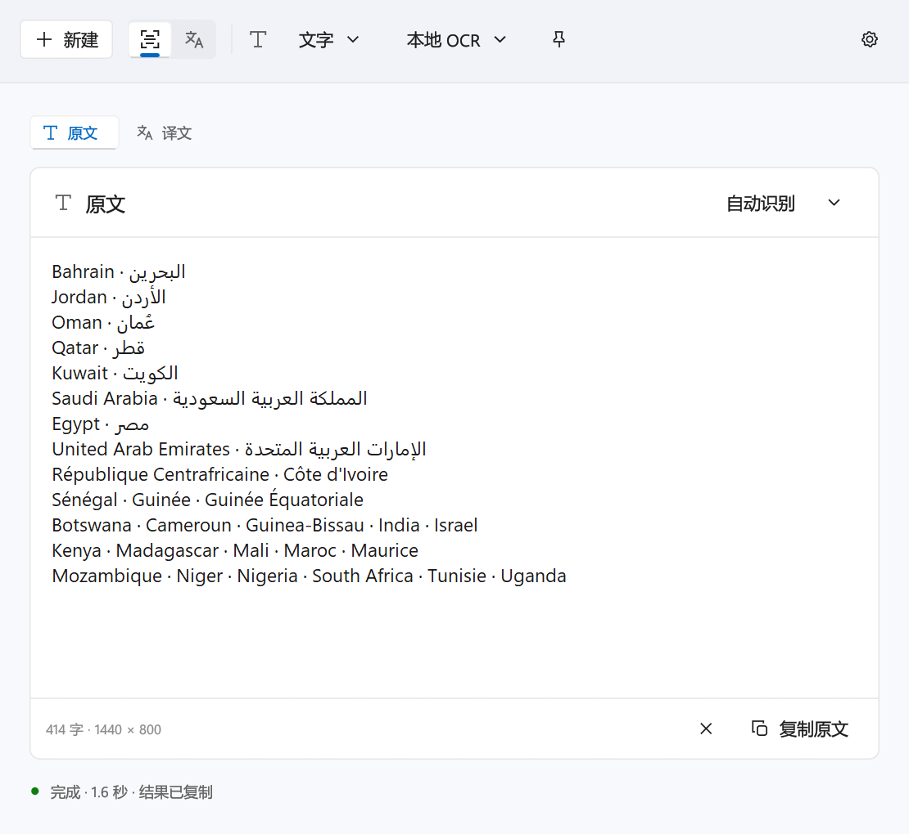
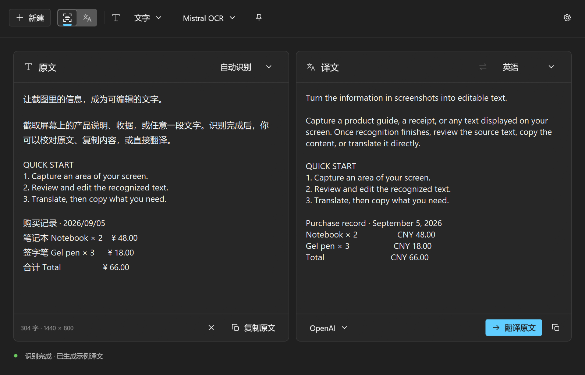
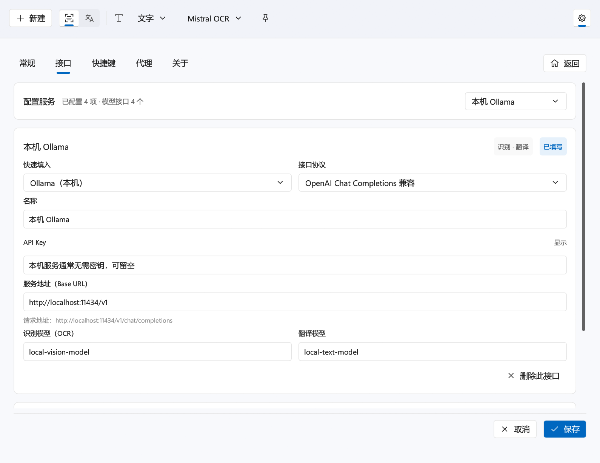

<div align="center">


# SightOCR

**Windows 截图识别与翻译工具**

框选屏幕即可识别文字、表格和公式，一键翻译并复制。本地离线识别，也可接入百度、腾讯与各类大模型接口。

[](https://github.com/FueTsui/SightOCR/releases/latest)
[](https://github.com/FueTsui/SightOCR/actions/workflows/rust.yml)
[](LICENSE)


[下载](https://github.com/FueTsui/SightOCR/releases/latest) · [使用说明](docs/USAGE.md) · [安装与升级](docs/INSTALLATION.md) · [MCP 与 Skill](docs/MCP.md)

</div>

<p align="center">
  
  &nbsp;
  
</p>

## ✨ 特性

- **三种识别类型**：文字、表格（输出 TSV，可直接粘贴到 Excel）、公式（输出 LaTeX）。
- **本地离线识别**：默认使用本地 OneOCR 引擎（来自 Windows 截图工具），截图只在内存中处理，不联网。
- **表格还原**：支持浅色、断线、深色主题、斑马纹、轻微倾斜和斜拍照片等表格。
- **版面分析**：识别双栏排版与段落，把因宽度换行的行合并成整段，方便翻译。
- **多种翻译服务**：Bing（默认，免密钥）、百度、腾讯，以及自定义的大模型接口。
- **模型接口**：支持 OpenAI Chat Completions 兼容、OpenAI Responses、Anthropic Messages、Google Gemini、Mistral OCR 五种协议，可接入 Azure OpenAI、DeepSeek、通义千问、腾讯混元、Ollama、LM Studio 等。
- **多语言显示**：原生 Unicode 编辑控件，支持阿拉伯文等双向排版、印度及东南亚文字和输入法。
- **静默识别**：一键框选，结果直接进剪贴板，不弹窗口。
- **MCP 服务**：附带 `sightocr-mcp.exe` 和通用 Skill，让 AI 客户端调用识别与翻译。
- **轻量**：Rust + egui + Win32 编写，无需 Python、Qt 或其他运行时；日常运行无需管理员权限。

## 📥 安装

从 [Releases](https://github.com/FueTsui/SightOCR/releases/latest) 下载 `SightOCR-Setup-<版本号>.exe` 并运行。

- 系统要求：Windows 10 / 11 x64
- 默认安装到 `C:\Program Files\SightOCR`，覆盖安装会保留设置、密钥与快捷方式
- 程序内可自动检查更新，下载后校验 SHA256 再安装
- 可用发布附件 `SHA256SUMS.txt` 核对安装包

安装、升级、静默安装参数与卸载说明见 [Windows 安装包](docs/INSTALLATION.md)。

## 🚀 使用

启动后程序常驻托盘，通过快捷键随时截图：

| 快捷键 | 功能 |
| --- | --- |
| <kbd>F4</kbd> | 静默识别：框选后直接复制原文，不弹出窗口 |
| <kbd>F5</kbd> | 截图识别：显示结果并复制原文 |
| <kbd>F2</kbd> | 截图翻译：识别、翻译并复制译文 |
| <kbd>Esc</kbd> / 鼠标右键 | 取消截图 |

- 快捷键可在「设置 → 快捷键」中修改，直接按下组合键即可录入。
- 工具栏可切换识别类型（文字 / 表格 / 公式）和识别引擎（本地 / 云端）。
- 原文与译文都可编辑，修改后点击「翻译原文」重新翻译。
- 关闭窗口只是隐藏到后台；从托盘菜单「退出」才会结束程序。

### 识别引擎

| | 本地 OneOCR | 百度 / 腾讯 | 模型接口 |
| --- | :---: | :---: | :---: |
| 文字 | ✅ | ✅ | ✅ |
| 表格 | ✅ | ✅ | ✅ |
| 公式 | — | ✅ | ✅ |
| 翻译 | — | ✅ | ✅ |
| 需要联网 / 密钥 | 否 | 是 | 是（本机模型可免密钥） |

云端识别失败时会显示原因并回退到本地引擎。

### 配置云端服务

在「设置 → 接口」中填写百度、腾讯的密钥，或选择「＋ 添加模型接口」。「快速填入」可一键带出常见服务商的地址和默认模型，填上密钥并点「测试」即可使用。

<p align="center">
  
</p>

网络代理在「设置 → 代理」中配置，支持跟随系统、直连和手动指定 HTTP / SOCKS5 代理。

更多细节——表格识别规则、版面分析、各协议的请求格式、代理与配置文件——见 [使用说明](docs/USAGE.md)。

## 🤖 MCP 与 Skill

`sightocr-mcp.exe` 是本地 stdio MCP 服务，无需参数，不监听网络端口：

```json
{
  "mcpServers": {
    "sightocr": {
      "command": "C:\\Program Files\\SightOCR\\sightocr-mcp.exe",
      "args": []
    }
  }
}
```

提供 `sightocr_ocr`（本地识别图片）、`sightocr_translate`（翻译文本）、`sightocr_languages`（列出语言）三个工具。安装目录中的 `skills/sightocr/SKILL.md` 是配套的通用 Skill。详见 [MCP 与 Skill](docs/MCP.md)。

## 🛠️ 从源码构建

**准备环境**

- [Rust MSVC 工具链](https://rust-lang.org/tools/install/)（1.88 或更高）
- [Visual Studio C++ Build Tools 与 Windows SDK](https://learn.microsoft.com/en-us/windows/dev-environment/rust/setup)
- OneOCR 资源：源码不包含 OneOCR 的 DLL 与模型，可运行 `tests/ExtractOCR.bat` 从本机截图工具中提取到 `resources/oneocr/`（需要管理员权限）

**开发与检查**

```powershell
cargo run --locked --bin SightOCR
cargo fmt --all -- --check
cargo clippy --locked --all-targets -- -D warnings
cargo test --locked -- --test-threads=1
```

**打包**

```powershell
# 检查、测试、构建，并把程序和资源复制到 dist/SightOCR
powershell -NoProfile -ExecutionPolicy Bypass -File scripts/build.ps1

# 额外生成安装包 dist/installer/SightOCR-Setup-<版本号>.exe（使用自带安装程序，无需 Inno Setup）
powershell -NoProfile -ExecutionPolicy Bypass -File scripts/build.ps1 -Installer
```

<details>
<summary>构建说明</summary>

- 构建脚本串行运行测试，避免原生字体/焦点测试争用 Windows 桌面状态。
- 缺少 Windows 补充字体的验证机可传入 `-SkipOptionalFontTests`，只排除两项多语言字形覆盖测试；使用该选项时须在验证记录中注明。
- Cargo 未加入 PATH 时，脚本会自动寻找 `$env:USERPROFILE\.cargo\bin\cargo.exe`。
- 图标、版本号和 DPI manifest 嵌入 EXE；用户配置不随包发布。
- 公开 CI 运行默认测试；依赖补充字体和交互桌面的测试默认忽略，需在配置完整的 Windows 机器上串行执行。
- 其他回归脚本：`scripts/test-mcp.ps1`、`scripts/test-installer.ps1`（需 PowerShell 7，隔离验证安装 / 升级 / 卸载及 2.0.x 程序内更新兼容）、`scripts/test-updater.ps1`。
- 公开源码不包含 OneOCR 资源，也不包含真实业务表格及其派生夹具。
- 本地私有表格样本回归需备齐夹具后运行 `cargo test --locked --features private-table-samples -- --test-threads=1`；公开源码的默认检查不依赖这些文件。

</details>

<details>
<summary>项目结构</summary>

```text
rust/
├── main.rs            GUI 入口
├── console.rs         sightocr-mcp.exe 入口
├── app.rs             应用状态、任务与系统事件
├── config.rs          配置验证、迁移与原子保存
├── headless.rs        MCP 无界面识别与翻译任务
├── mcp.rs             本地 stdio MCP 协议与工具
├── ocr.rs             OneOCR FFI 与 COM 生命周期
├── ocr/               本地表格恢复与版面分析
├── platform.rs        截图、热键、托盘、自启、单实例
├── services.rs        云端 OCR、翻译、签名与令牌
├── services/ai.rs     模型接口（Chat / Responses / Anthropic / Gemini / Mistral OCR）
├── ui/                工作台、设置、主题与原生窗口样式
├── updater.rs         软件更新
└── worker.rs          有界队列、图像加载与引擎调度
scripts/               启动、构建与回归测试脚本
skills/sightocr/       配套通用 Skill
resources/oneocr/      OneOCR DLL 与模型（不随源码提供）
```

</details>

## 📚 文档

| 文档 | 内容 |
| --- | --- |
| [使用说明](docs/USAGE.md) | 各项功能的详细行为 |
| [Windows 安装包](docs/INSTALLATION.md) | 安装、升级、程序内更新与卸载 |
| [MCP 与 Skill](docs/MCP.md) | MCP 配置、工具列表与排错 |
| [界面设计记录](docs/UI_DESIGN.md) | 视觉规范与验证范围 |
| [重构记录](docs/RUST_REFACTOR.md) | Rust 重写的问题清单与人工回归项 |
| [验证记录](docs/VALIDATION.md) | 各版本实测结果 |

## ⚠️ 已知限制

- 本地引擎不支持公式识别，请使用云端服务。
- 强烈透视或弯曲的照片、看不清的斜线表头、复杂合并单元格需要人工校对。
- 多屏混合 DPI、远程桌面和云端账号权限需在实际环境中验证。
- 服务密钥以明文保存在本机配置文件中（界面中遮罩显示），并非加密存储。
- Arm64 Windows 的 x64 模拟环境尚未验证。

## 📝 更新日志

**2.1.0**
- 原 Mistral、OpenAI、NVIDIA 固定接口统一为可自定义名称的「模型接口」，支持五种标准协议，用于识别（文字 / 表格 / 公式）与翻译；旧配置自动迁移。
- 设置页增加服务商快速填入、请求地址实时校验与连接测试。
- 本地表格识别支持深色主题与斑马纹表格；中文、日文单元格换行不再插入多余空格。
- 优化按钮、切换、复制反馈、等待页等动效，并遵循 Windows「显示动画」设置。

**2.0.3**
- 修复运行期间切换 Windows 系统代理后仍沿用旧连接的问题，新任务自动刷新代理与服务会话。

完整历史见 [Releases](https://github.com/FueTsui/SightOCR/releases)。

## 📄 许可

SightOCR 第一方代码由 FueTsui 编写，采用 [MIT 许可](LICENSE)。

OneOCR DLL / 模型及其他第三方组件保留各自的作者、版权和许可。
